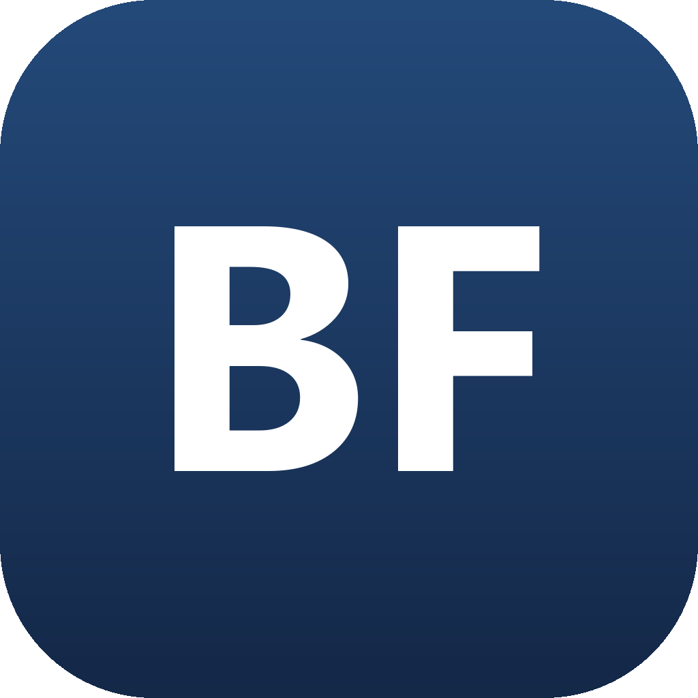

# BFSIM

> ## About this fork
>
> **BFSIM** is **BF Robotics' fork** (maintained by gelosan3d) of
> [genius0412/dsim](https://github.com/genius0412/dsim) — **DSIM, created by Dohun Kim** — the
> simulator behind [playdsim.com](https://www.playdsim.com/). All of the simulator, game and
> netcode work is the original author's and is used under the PolyForm Noncommercial License 1.0.0
> (see [`LICENSE`](./LICENSE) and [`NOTICE`](./NOTICE)). This fork is a **noncommercial** team
> project: it is not affiliated with, endorsed by or sponsored by DSIM, its author or its sponsors.
> The name, icons and logos here are **placeholders** for BF Robotics. Everything below the line is
> the original project's README; this box covers what is different here.
>
> **What this fork adds**
>
> - **Switch drive style mid-match.** Press **H** to swap between field-centric ("headless")
>   and robot-centric driving at any time, on keyboard or gamepad. The match starts in the
>   style picked under *Configure → Robot → Driving → Drive style*; a label under the status
>   bar (FIELD-CENTRIC / ROBOT-CENTRIC) shows when you have switched away from it, and
>   restarting puts you back. The key can be rebound, and a gamepad button assigned, under
>   *Configure → Controls → All games → Driving → Switch drive style* (the gamepad starts
>   unbound). A pure tank drivetrain ignores it.
>
> **What this fork removes**
>
> - **DECODE presented by RTX** (FTC 2025–26). Its simulator, field, scoring, fouls, tutorial,
>   start-position editor and auto paths are gone; **BIOBUZZ** is the default game and
>   **Chain Reaction** is the other. The controls stay, including both control schemes; the
>   FTC25 shooter presets are kept (still bindable, with their powers) for BIOBUZZ's launcher,
>   which does not read them yet. DECODE replays and runs recorded earlier will not play here,
>   and an old `/decode/…` link opens that screen in whichever game you last picked. The
>   original README below still lists DECODE.
>
> **Branches**
>
> - `my-changes` holds this fork's work. Use it.
> - `main` is kept as an unchanged copy of genius0412's `main`, so the original project's
>   updates can be merged into `my-changes` without overwriting anything here.
>
> **Rebranded.** The app is named BFSIM, the icons and logos are placeholders, and the original's
> site, Discord and Instagram links are removed or pointed at this repository. The presenting-sponsor
> slot now reads "BF Robotics" (placeholder artwork). The desktop shell loads its bundled build; set
> `BFSIM_SITE_URL` (and `VITE_SITE_URL` for the web build) if you host your own copy.
>
> **De-monetised.** There are no ads, no Ko-fi or payment routes and no paid tier: the former
> supporter cosmetics and the larger saved-start limit are free for everyone. The privacy policy
> and terms are rewritten for a noncommercial fork, with the issue tracker as the contact.
>
> These changes run only when you run this fork yourself. playdsim.com and the official desktop
> app are the original project and do not include them.
>
> ### Run it locally
>
> You need **[Node.js](https://nodejs.org/) 22 LTS or newer** and
> **[Git](https://git-scm.com/)**.
>
> 1. Open a terminal (on Windows: *Terminal* or *PowerShell* from the Start menu) in the folder
>    you want the project in, and download it:
>
>    ```bash
>    git clone https://github.com/gelosan3d/dsim_BFRobotics.git
>    cd dsim_BFRobotics
>    git switch my-changes
>    ```
>
> 2. Install the dependencies (a few minutes the first time; warnings are normal):
>
>    ```bash
>    npm ci
>    ```
>
> 3. Start it, then open **<http://localhost:5173>** in your browser:
>
>    ```bash
>    npm run dev
>    ```
>
>    Leave that terminal open while you play; press **Ctrl + C** in it to stop.
>
> On Windows, if PowerShell says *running scripts is disabled on this system*, run
> `Set-ExecutionPolicy -Scope CurrentUser RemoteSigned`, answer **Y**, and try again.
>
> To check nothing is broken after a change: `npm test` (headless simulation checks,
> a few minutes) and `npm run build`.
>
> **What works when you run it yourself.** Both games, solo practice, free drive, the
> tutorial, the robot builder, and every control and setting (saved in your browser).
>
> **What does not.** Accounts, sign-in, ranked play, leaderboards and records all depend on the
> original project's private servers, so they are unavailable. Multiplayer is hidden unless you
> run your own game server: create a file named `.env` in the project folder containing
> `VITE_GAME_SERVER_URL=ws://localhost:8787`, run `npm run server` in a second terminal, and
> restart `npm run dev`. That lets you test multiplayer on your own computer, for example from
> two browser tabs, with no leaderboards.

---



A 2D/3D driver-practice simulator for FIRST Tech Challenge. Vite + React +
TypeScript on Canvas 2D, with a Rapier3D + Three.js path for games that use it.

Three games ("seasons") are playable:

- **DECODE presented by RTX** (FTC 2025–26) — full solo match + free drive,
  scoring per manual, motif randomization, physical basin/rail/gate classifier.
- **Chain Reaction** (2026 Unofficial-FTC CAD-competition game) — 300-particle
  bespoke physics, three shooter archetypes, catalysts and hooks, ring-stand
  ascend/descend.
- **BIOBUZZ presented by RTX** (FTC 2026–27) — full match, scored and ranked,
  playable in 2D or 3D physics + view.

## Play

Run it locally (see above). The original project is hosted at
[playdsim.com](https://www.playdsim.com/); that is **not** this fork.

## Features

- **Solo practice** against AI opponents (where the game has them), plus free
  drive with no opponent.
- **Online multiplayer** through an authoritative game server (Node + `ws` on
  Fly), so all players share one authoritative simulation rather than syncing
  peer state.
- **Accounts**: Glicko-2 ranked play, leaderboards, and personal-best/world-record
  tracking, kept separately per game.
- **Replays**, recorded from real matches and exportable as video.
- **LAN / self-hosting**: a tab on your own network can host a room without the
  public game server.
- **In-app tutorial** for learning the controls and objective of a game.
- **Desktop build** (Electron) for Windows/macOS/Linux, downloadable from the
  site or built from source.

## Run it

```bash
npm install
npm run dev        # dev server at http://localhost:5173
npm test           # headless sim verification (both games)
npm run build      # tsc (strict) + vite build
npm run server     # the authoritative game server, locally
```

Deployment: the client is a static Vite build, deployed to Vercel with zero
configuration; the game server runs on Fly. See `docs/deploy.md` and
`docs/area/netcode.md` for the actual deploy protocol — it has rules that are
expensive to get wrong.

## Desktop app (Electron)

```bash
npm run electron   # run the desktop shell against the current build
npm run dist       # package a Windows installer into release/
```

## Contributing

Contributions are welcome — read [`CONTRIBUTING.md`](./CONTRIBUTING.md) first.
All contributors must agree to the [Contributor License Agreement](./CLA.md).

The engineering rules live in [`CLAUDE.md`](./CLAUDE.md) (what is true
everywhere) and `docs/area/` (the guide for whatever you're about to touch) —
read the one for your area before your first edit there.

## License

Source-available under the [PolyForm Noncommercial License 1.0.0](./LICENSE):
you may use, study, modify, and share it for **noncommercial** purposes.
Commercial use requires a separate license from the copyright holder. This is
*not* an OSI open-source license.

This project is an independent, fan-made simulator, not affiliated with,
authorized by, endorsed by, or sponsored by FIRST, FIRST Tech Challenge, or
RTX Corporation. "FIRST", "FTC", "DECODE", "DECODE presented by RTX", and
"RTX" are trademarks and/or copyrighted works of their respective owners,
referenced here only to describe, factually, the real-world games this
simulator practices for. See [`NOTICE`](./NOTICE) for the full disclaimer and
third-party software credits.
